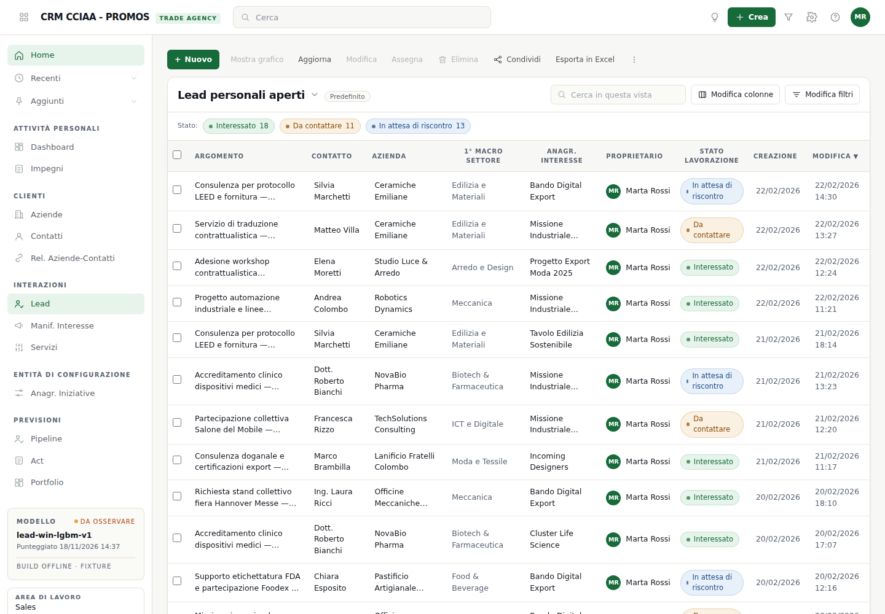
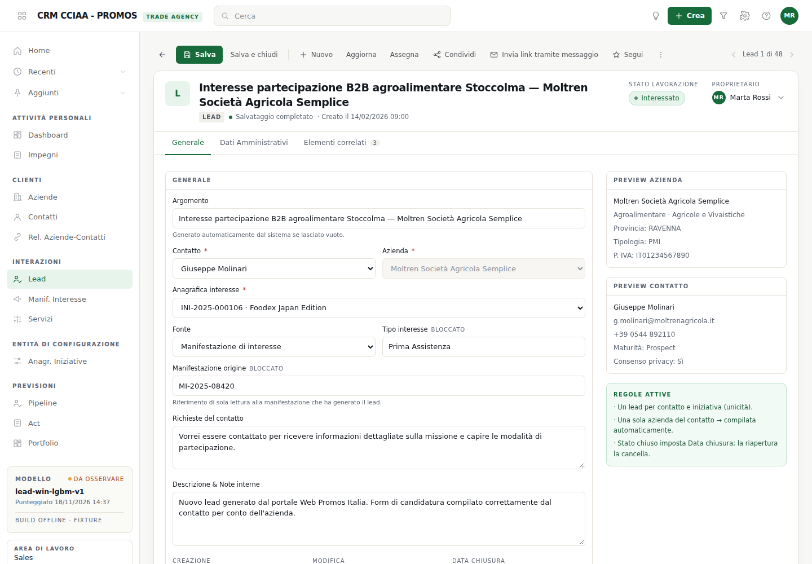

# CRM UI — what the P0 demo implements

Written 2026-11-20, after the four handoff PRs merged (`main` @ `562e877`) and the
T15 UI lane landed. This is the **implementation record**, not the independent
verification report: `docs/VERIFICATION_REPORT.md` (T17, Gemini) is still outstanding.

**Information architecture (Q1).** The CRM is the shell and opens at `/`. The five ML
screens moved under `/previsioni`; old links (`/leads/:id`, `/act`, `/portfolio`)
redirect, so nothing that pointed at the ML demo broke.

## Screens

| Lead personali aperti | Scheda Lead |
|---|---|
|  |  |

## P0 inventory → component

Every P0 row from `docs/UI_FEATURE_INVENTORY.md` has a component and a verified
behaviour. P1/P2 rows are listed as gaps at the end.

| ID | Feature | Where |
|---|---|---|
| A1 | Top bar, app name `CRM CCIAA - PROMOS`, `TRADE AGENCY` | `components/CrmShell.tsx` |
| A3 | Assistant, `+ Crea`, advanced find, settings, help, avatar | `components/CrmShell.tsx` |
| A4 | Collapsible nav with the exact Italian groups/items | `components/CrmShell.tsx` |
| A7 | Italian locale, `dd/mm/yyyy HH:mm`, Europe/Rome | `lib/i18n.ts` |
| B1 | View title + `Predefinito` badge + view selector (7 system views) | `crm/LeadListPage.tsx` |
| B2 | Command bar: `Nuovo`, `Mostra grafico`, `Aggiorna`, `Modifica`, `Assegna`, `Elimina`, `Condividi`, `Esporta in Excel`, `⋮` | `crm/LeadListPage.tsx` |
| B3 | `Modifica colonne` + `Modifica filtri` panels | `crm/LeadListPage.tsx` |
| B4 | The 9 default grid columns | `crm/LeadListPage.tsx` |
| B5 | Row checkboxes, select-all, `Modifica (N)` on selection | `crm/LeadListPage.tsx` |
| B7 | `1 - N di N record`, page size 50, pager | `crm/LeadListPage.tsx` |
| B8 | Double-click / link on `Argomento` opens the record | `crm/LeadListPage.tsx` |
| C1 | Form command bar: back, `Salva`, `Salva e chiudi`, `+ Nuovo`, `Aggiorna`, `Assegna`, `Condividi`, `Invia link`, `Segui`, `⋮` | `crm/LeadFormPage.tsx` |
| C2 | Header: title, `Salvataggio completato` / `Non salvato`, entity label, status + owner | `crm/LeadFormPage.tsx` |
| C4 | Tabs `Generale`, `Dati Amministrativi`, `Elementi correlati` | `crm/LeadFormPage.tsx` |
| C5 | All P0 fields incl. read-only `Manifestazione origine`, `Tipo interesse` | `crm/LeadFormPage.tsx` |
| C6 | `*` required markers, locked fields, disabled lookups | `crm/LeadFormPage.tsx` (`Field`) |
| C11 | Status catalogue as a table (14 statuses, open/closed, legacy) | `crm/seed.ts` (`STATUSES`) |
| C12 | Closed status sets `Data chiusura`; reopening clears it | `crm/store.tsx` (`applyStatus`) |
| C13 | Header flyout then `Salva` | `crm/LeadFormPage.tsx` |
| C14 | One lead per `(Contatto, Iniziativa)`, warning links to the existing lead | `crm/store.tsx` (`findDuplicate`) |
| C15 | One company auto-fills; several force a filtered choice | `crm/store.tsx` (`companiesForContact`) |
| C17 | Owner flyout / `Assegna`; leaves the old owner's open view | `crm/LeadFormPage.tsx`, `crm/LeadListPage.tsx` |

## Behaviour gate

`web/scripts/check-crm.mjs` (`pnpm --dir web check:crm`) drives the built app in a real
browser and asserts 13 behaviours: required fields, auto-link + locked lookup, the
uniqueness warning and its clearing, save + saved state, the closing-date hook, the
record leaving `Lead personali aperti` when closed, reassignment, the view selector and
the column picker.

Run against the final build:

```
13/13 interaction checks passed
```

## D1 gate

`web/scripts/check-ui.mjs` (`pnpm --dir web check:ui`) on the same build:

```
Visited 23 route(s) · 13 templates · axe: no violations
broken links: none · failed subresources: none · PASS
```

Two contrast fixes were needed and applied: the brand green `#1F8A4C` with white text
was 4.38:1 (below AA) and is now `#176B3B`; the muted `LEAD` badge on `#F1EFEA` was
lifted to `#4C5563`.

## Seed

`web/src/crm/seed.ts` is deterministic and Italian: 12 aziende, 14 contatti, 8
iniziative, 48 lead (42 open + 6 closed), 14 statuses. The builder enforces
`(Contatto, Iniziativa)` uniqueness in the data itself, so the grid and the rule agree.
Counts are computed from the arrays — the tab chips and footer are not hand-typed.

## Gaps carried forward (P1/P2, listed and owned)

| Gap | Priority | Note |
|---|---|---|
| Global `Cerca` is lead-scoped, not cross-entity type-ahead | P1 | A2 partial |
| Personal views (save / save-as / reset / share) | P1 | B11 |
| Excel export | P1 | CSV export implemented instead (B15) |
| Charts pane, dashboards, reports | P2 | B16 |
| Excel import/templates | P2 | B17 |
| Timeline composer (new activity), mailbox sync | P1/P2 | C9/C18/C19 — display only |
| Three manual creation entry points from Contact/Company/Initiative | P1 | C16 — route supports prefill, no entry buttons yet |
| Intake APIs, notifications, audit trail | P1 | D1/D2/D4/D6 — backend lane (T13) |
| `Rel. Aziende-Contatti`, `Manif. Interesse`, `Servizi`, `Dashboard`, `Impegni` | P1/P2 | `/non-incluso` screen names the gap |
| `Recenti` / `Aggiunti` expandable lists, workspace switcher | P2 | A5/A6 |

## Tests

- `python -m pytest -q` → **191 passed** on this tree.
- `npx tsc --noEmit` → clean.
- `npx vite build` → clean.
- `check:crm` → **13/13**.
- `check:ui` → **PASS**, 0 violations.
