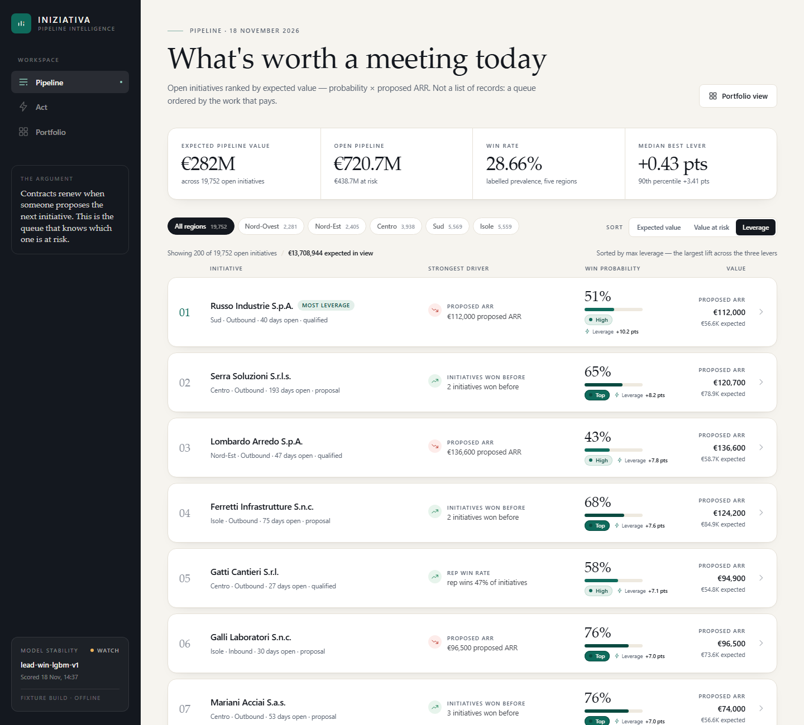
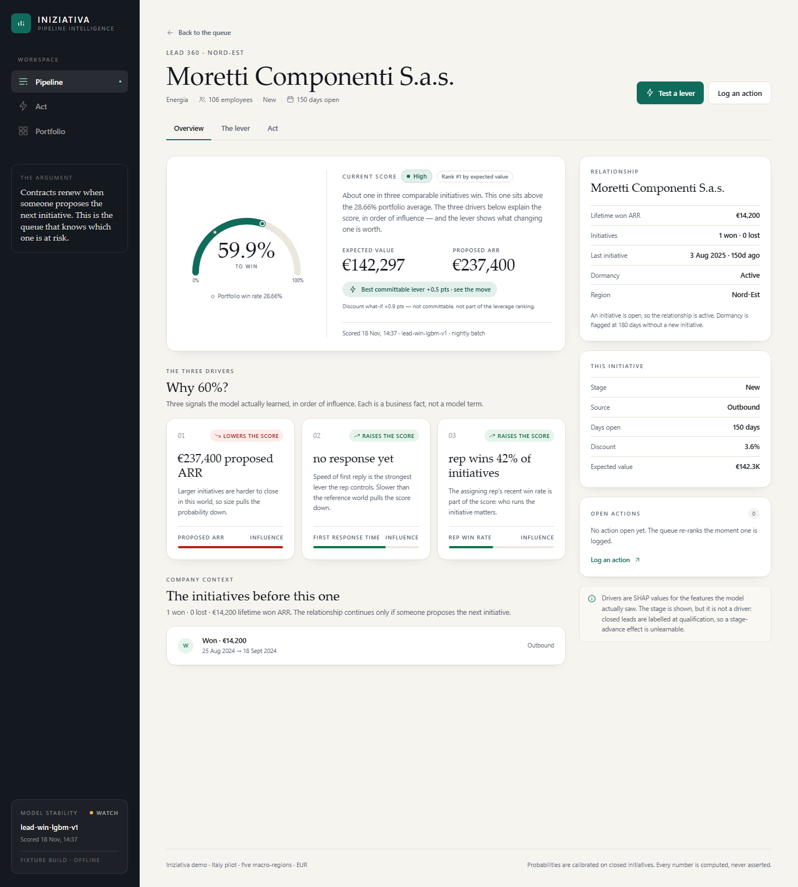
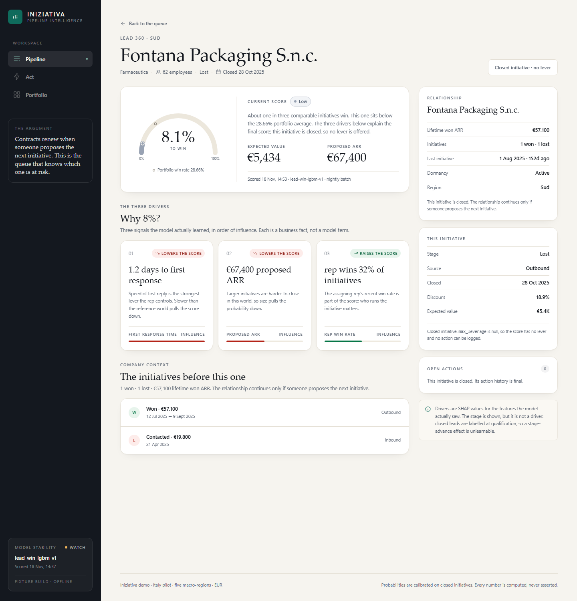
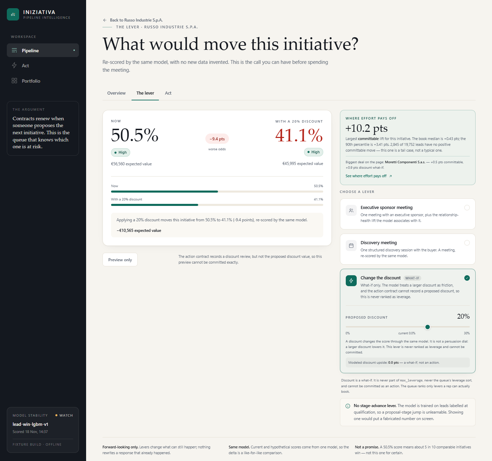

# Iniziativa — web

The pitch demo's UI. Five screens, one argument: a CRM for a business with no
renewal date, where the first screen is the open initiatives ranked by expected
value and every probability explains itself.

React + Vite + TypeScript + Tailwind + Recharts. The fixture build runs with no
backend; `VITE_API_BASE` switches the same UI to FastAPI. The fixtures are
generated from the running API, not authored by hand.

| Screen | What it proves |
|---|---|
| [Pipeline](#pipeline-queue) | The first screen is a ranked queue, and it sorts by where effort pays off. |
| [Lead 360](#lead-360) | Every probability explains itself in three business drivers. |
| [The lever](#the-lever) | The rep can see the committable move before spending the meeting. |
| [Act](#act) | Logging the meeting re-scores the lead and moves it 100 places. |
| [Portfolio](#portfolio) | Five regions, one calibrated model; 34% means 34%. |

---

## Run it

Requires Node 20+ and pnpm. The fixture build is the default.

```sh
pnpm --dir web install
pnpm --dir web dev
```

Open <http://localhost:5173>. The JSON fixtures are bundled; there is no API
call, database or network fetch in this mode.

```sh
pnpm --dir web build     # tsc --noEmit && vite build
pnpm --dir web preview   # serves dist on http://localhost:4173
```

### Regenerate the fixtures from the live stack

The fixtures are outputs, not source. The generator reads the running API and
the demo database; it never comes up with a number on its own.

```powershell
python tools/run_pipeline.py
python -m uvicorn api.app:app --host 127.0.0.1 --port 8000
pnpm --dir web fixtures
```

`pnpm --dir web fixtures` is `node scripts/build-fixtures.mjs`. It reads:

- `GET /api/pipeline?limit=200` — the queue, the real totals, every leverage row
- `GET /api/leads/{id}` — all 200 lead details plus one closed lead
- `GET /api/companies/{id}` — the demo companies' signals and initiative history
- `GET /api/portfolio` — regions, calibration, stability
- `POST /api/leads/{id}/counterfactual` — all nine lever states for every row
- `ml/artifacts/metrics.json` — AUC, ECE, latent ceiling, lift@10
- the SQLite database — **total open ARR**, labelled win prevalence, and a
  deterministic closed lead. Those totals are not in the pipeline payload.

`API_BASE` overrides the API (default `http://127.0.0.1:8000`), `DB_PATH` the
database, and `FIXTURE_CONCURRENCY` the request fan-out. The generator validates
the generated world against the live totals before it writes anything.

## Point it at the live API

```sh
VITE_API_BASE=http://localhost:8000 pnpm --dir web dev
# or, for a static bundle:
VITE_API_BASE=http://localhost:8000 pnpm --dir web build
```

Vite reads the variable at startup/build time. The API allows the demo origins
`:5173` and `:8080`; use one of those. There is no silent fixture fallback: if
the service is down, the boot card says so.

Endpoints used:

| Call | Where |
|---|---|
| `GET /api/pipeline?limit=200` | Pipeline queue. The limit is 200 because the leverage tail (Russo, rank 170) must be reachable. |
| `GET /api/leads/{id}` | Lead 360, lever and Act |
| `GET /api/companies/{id}` | Lead 360 relationship signals and full initiative history |
| `GET /api/portfolio` | Regions, calibration, stability |
| `GET /api/health` | Model version and last scoring time |
| `POST /api/leads/{id}/counterfactual` | The lever's re-score |
| `POST /api/leads/{id}/actions` | Act's write, then the re-score |

---

## The generated world

| Fact | Value |
|---|---|
| Open initiatives | **19,752** |
| Total open proposed ARR | **€720,720,300** |
| Expected pipeline value | **€282,045,124.59** |
| Value at risk | **€438,675,175** |
| Region split | 2,281 / 2,405 / 3,938 / 5,569 / 5,559 |
| Labelled win prevalence | **28.664%** (11,511 / 40,158) |
| Committable leverage median | **0.00425** (+0.43 pts) |
| Committable leverage p90 | **0.03410** (+3.41 pts) |
| No positive committable move | **2,845** of 19,752 leads |
| Discount what-if median / p90 | 0.03242 / 0.16899 |
| Model | AUC 0.772915 · calibration 0.010442 · latent ceiling 0.788589 · lift@10 2.262 |
| Stability | PSI 0.170665, watch; holdout mean p 35.9924% vs train 27.1667%; win rate 35.122% vs 27.0497% |
| Closed lead for `max_leverage: null` | `L000010` (lost) |

The queue's first three rows by expected value:

| Rank | Lead | Company | p | EV | Committable leverage | Discount what-if |
|---|---|---|---|---|---|---|
| 1 | `L021037` | Moretti Componenti S.a.s. | 59.94% | €142,296.58 | +0.47 pts | +0.89 pts |
| 2 | `L029491` | Costa Officine S.a.s. | 67.17% | €128,368.44 | +0.38 pts | 0 |
| 3 | `L049535` | Giuliani Cantieri S.r.l. | 69.42% | €128,355.28 | +5.42 pts | +5.21 pts |

The first three rows by the **leverage sort** (committable levers only):

| Rank | Lead | Company | p | EV | Committable leverage |
|---|---|---|---|---|---|
| 1 | `L021729` | Russo Industrie S.p.A. | 50.50% | €56,560.04 | **+10.16 pts** |
| 2 | `L017645` | Serra Soluzioni S.r.l.s. | 65.38% | €78,911.88 | +8.24 pts |
| 3 | `L042381` | Lombardo Arredo S.p.A. | 43.01% | €58,746.77 | +7.78 pts |

### The hero: Russo Industrie

`L021729 Russo Industrie S.p.A.` is the demo lead for **both** the lever and
Act beats:

- Current probability **50.500%**, EV **€56,560.04**, ARR €112,000, rank **170**.
- Executive sponsor meeting: **50.500% → 60.659%**, **+10.16 points**,
  EV **€67,938**, rank **170 → 71**.
- It is a tail case, not a typical one: the committable median is **+0.43 pts**
  and 2,845 of 19,752 leads have no positive committable move.
- The biggest deal on the page, Moretti, is worth only **+0.47 committable** and
  **+0.89 as a discount what-if**. `max_leverage` excludes the discount; the
  contrast is the pitch.

The previous hero, `L045346 Rossi Componenti S.r.l.s.`, has a **discount
what-if** of +19.5 pts. It lives only in the discount lane, labelled
"what-if, not committable"; it is never the headline and never part of the
leverage sort.

---

## The five screens

### Pipeline queue


- **€282.0M expected value** across 19,752 open initiatives, **€720.7M open**,
  **€438.7M at risk**, 28.66% labelled win rate, and median best lever
  **+0.43 pts** (p90 **+3.41**).
- Region filter with real counts and three sorts: expected value, value at risk,
  and **leverage**. Leverage is `max_leverage`, which counts only committable
  levers; discount is excluded.
- 200 queue rows, each a card: rank, company, region/source/days open, the
  strongest driver, probability with the model's probability band, proposed
  ARR, expected value and committable leverage. The top row is Moretti; the
  leverage sort is led by Russo.
- The queue says "Showing 200 of 19,752" because the API serves the top page;
  the totals are whole-book.



### Lead 360



- Moretti Componenti: **59.9%**, **€142,297 expected**, **€237,400 ARR**, rank
  #1, high probability band, 150 days open, new.
- Three drivers in business sentences, in SHAP order: **€237,400 proposed ARR**
  (bigger deals close less often), **no response yet**, **rep wins 42% of
  initiatives**. Company signals come from `/api/companies/{id}`: €14,200
  lifetime won ARR, 1 won / 0 lost, latest initiative 150 days ago, active.
- "Best committable lever +0.5 pts" links to the lever; a separate line says
  "Discount what-if +0.9 pts — not committable, not part of the leverage
  ranking." The 0.9 is the contrast, not a recommendation.
- Closed lead `L000010` exercises `max_leverage: null`: the 360 renders its
  score and history, but no lever chip, no lever/act CTAs and no lever tabs.



### The lever


- Russo Industrie: **50.5% → 60.7%** with an executive sponsor meeting,
  **+10.2 pts**, EV **€56,560 → €67,938**. A real, committable action.
- "Where effort pays off" puts it in context: **+10.2 committable**, against a
  **+0.43-point book median** and **+3.41-point p90**; 2,845 of 19,752 leads
  have no positive committable move, so this is the rare tail.
- The biggest deal on the page is called out with both numbers: Moretti
  **+0.5 committable**, **+0.9 discount what-if**.
- Discount is a slider under a **What-if** badge. It is clearly labelled as not
  committable, never ranked in `max_leverage`, and the action contract cannot
  record a proposed discount. If the discount gets selected, the screen shows
  its delta as a preview only.
- No stage-advance lever. The model cannot learn it.



### Act


- Defaults to Russo, the same lead as the lever beat, so the story does not
  jump accounts. Four action kinds from the contract plus an optional note.
- Logging the executive sponsor meeting: **50.5% → 60.7% (+10.2 pts)**,
  EV **€56.6K → €67.9K**, rank **#170 → #71**. The before/after queue shows the
  reordered window around both positions.
- The action response returns probability and delta; expected value and rank
  are computed from the proposed ARR already in the queue. The queue re-ranks
  client-side.

### Portfolio


- **€282.0M** expected value across 19,752 open initiatives; 28.66% win rate;
  AUC 0.773; calibration error 0.0104.
- Pipeline by region (real API values) and win rate by region, with the 28.66%
  benchmark marked.
- Calibration chart: ten real decile bins, predicted vs actual, with the
  perfect-calibration diagonal and ECE 0.0104.
- **Model stability · holdout vs train**: PSI 0.171, **Watch**, holdout mean
  probability 36.0% vs train 27.2%, win rate 35.1% vs 27.0%. A real base-rate
  shift in the synthetic world, not a model fault.
- If `/api/portfolio` omits the four optional stability fields because the
  labelled population cannot be split, the panel says **Not measurable** and
  shows no fallback numbers.

---

## Probability bands

The contract's `Band` enum is defined by `ml/train.py`, not by the OpenAPI file:

| Band | Probability | Shown as |
|---|---|---|
| low | `< 20%` | Low |
| medium | `20% – < 40%` | Medium |
| high | `40% – < 60%` | High |
| critical | `≥ 60%` | **Top** |

These are **win-probability bands**, not risk ratings. The UI labels the
contract's `critical` band "Top" so a 68% win probability does not read like a
red alert. Re-scores use the same cut-points.

## Model numbers

`ml/artifacts/metrics.json` is the source for AUC, calibration, latent ceiling
and lift. The generator copies those into `src/fixtures/metrics.json`; the UI
does not type them by hand. The API carries the calibration bins and stability
context, not the discrimination metrics.

## What the contract does not carry

These are the places where the screen needed something the OpenAPI file does
not provide. None of them is hidden behind a made-up number.

| Gap | Screen impact | What this build does |
|---|---|---|
| Pipeline has no total open ARR | The queue's `€720.7M open` is not in `/api/pipeline` | The fixture generator reads it from the demo DB; live mode shows `—` for open ARR until the API exposes it |
| Portfolio has no total open ARR or labelled prevalence | The queue/lead benchmark and open total | Fixture generator reads both from the DB; live mode falls back to the open-weighted regional rate for the benchmark |
| Portfolio has no AUC, ECE, latent ceiling | The "three numbers to have ready" are not in the payload | Generated `src/fixtures/metrics.json` from `ml/artifacts/metrics.json` |
| Portfolio has no time series | No honest trend chart | Region bars + calibration (Recharts) + one stability panel; no fabricated trend |
| Stability fields are optional | A population that cannot be split has no comparison | The panel shows **Not measurable** and never falls back to a constant |
| `max_leverage` is committable-only; `discount_upside` is separate | The queue must not rank discounts | The sort and row use `max_leverage`; discount is a labelled what-if only |
| `LeadDetail.max_leverage` is nullable | A closed lead has no lever | The 360 hides the chip, CTAs and lever tabs for closed leads |
| `Band` cut-points live in `ml/train.py`, not OpenAPI | Band naming | UI applies the model's cut-points; `critical` is shown as Top |
| `ActionRequest` has no discount value | A discount preview cannot be committed | Discount is Preview only; meeting levers commit and carry their kind into Act |
| `ActionResponse` has no expected value, rank or drivers | The loop cannot read the new position from the write | EV = `probability_after × amount_arr`; rank re-computed client-side |
| `PipelineItem` has no open-action state | The API cannot name the "next call" | Act default is generated as the strongest committable exec action (`L021729`) and the picker covers the top 200 |
| `total_expected_value` scope is undefined | Headline could be misread | Fixtures/API use all matches; the queue says "200 shown of 19,752" |
| `CounterfactualResponse` has no per-driver change | The lever can say what moved, not which feature | The API `explanation` string is shown verbatim |

### One docs mismatch

`docs/PITCH.md` (2:30) and `docs/RUNBOOK.md` still say the median best lever is
**4 points / +4.19 points**, and the RUNBOOK mentions a 17.3-point hero. The
measured committable distribution is **+0.43 median / +3.41 p90**; 2,845 leads
have no positive committable move. The screens and this README use the measured
values. Those two docs lines need a copy edit; the pitch's Russo beat (10.2
points, rank 170→71, Moretti 0.9 discount what-if) already matches the UI.

---

## File map

```
web/
  index.html
  package.json, pnpm-lock.yaml, pnpm-workspace.yaml
  vite.config.ts, tsconfig.json, tailwind.config.js, postcss.config.js
  scripts/build-fixtures.mjs      # API + DB -> committed fixtures
  src/
    main.tsx, App.tsx, index.css
    components/  AppShell, ui (dial, band, cards), QueueRow, RegionFilter,
                 LeadTabs, icons
    pages/       PipelinePage, LeadPage, LeverPage, ActPage, PortfolioPage
    lib/         types, api (fixture/live switch), bands, format, metrics,
                 model, narratives, stability
    state/       PipelineProvider (queue, lead overrides, action re-rank)
    fixtures/    generated JSON (pipeline, leads, companies, counterfactuals,
                 actions, best-levers, portfolio, health, metrics, demo)
  screenshots/   captures from the fixture build
```

No file outside `web/` is modified by this lane. `web/dist/`, `node_modules/`
and logs are ignored.

## Verification

```sh
pnpm --dir web install --frozen-lockfile
pnpm --dir web build
pnpm --dir web dev
```

Last build:

```
dist/index.html                     0.62 kB │ gzip:   0.37 kB
dist/assets/index-D3W1iQVg.css     31.06 kB │ gzip:   6.62 kB
dist/assets/index-DKdmq4V3.js   1,522.89 kB │ gzip: 300.89 kB
✓ built
```

The bundle is large because the fixtures for 200 queue rows are bundled for
instant, offline navigation and the Recharts portfolio is included. That is a
deliberate demo trade; there is no route-level spinner. The normal build never
calls the API.

The live path was tested against lane C's committable-leverage API on port 8001:
200 rows, Russo first in the leverage sort, Lead 360 Moretti, lever Russo
50.5→60.7, Act 50.5→60.7 / #170→#71, portfolio stability present. A
not-measurable stability pass was also tested by stripping the optional fields.
CI runs the fixture build only; `pnpm --dir web fixtures` requires the API/DB.
