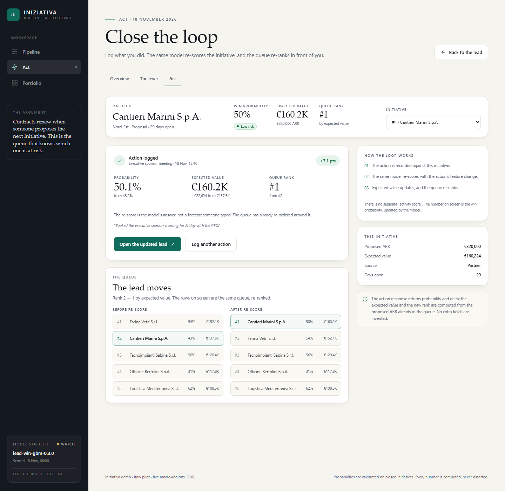
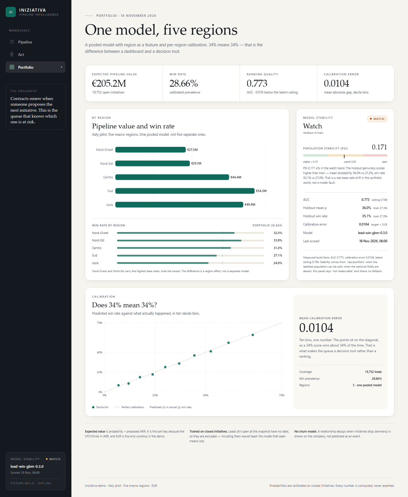
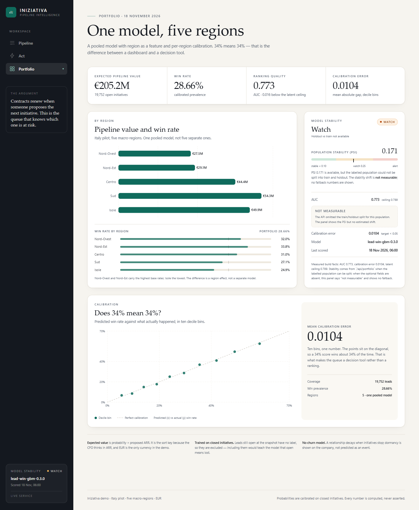

# Iniziativa — web

The pitch demo's UI. Five screens, one argument: a CRM for a business with no
renewal date, where the first screen is the open initiatives ranked by expected
value and every probability explains itself.

React + Vite + TypeScript + Tailwind + Recharts. The fixture build runs with no
backend, no network and no web fonts. `VITE_API_BASE` switches the same UI to
the FastAPI service.

| Screen | What it proves |
|---|---|
| [Pipeline](#pipeline-queue) | The first screen is a ranked queue, not a list of records — and it sorts by where effort pays off. |
| [Lead 360](#lead-360) | Every probability explains itself in three business drivers. |
| [The lever](#the-lever) | The rep can see what would move it before spending the meeting. |
| [Act](#act) | Logging an action re-scores the lead and moves it in the queue. |
| [Portfolio](#portfolio) | Five regions, one calibrated model; 34% means 34%. |

---

## Run it

Requires Node 20+ and pnpm. The fixture build is the default.

```sh
pnpm --dir web install
pnpm --dir web dev
```

Open <http://localhost:5173>. There is no API call, no database and no network
fetch in this mode; the JSON fixtures are bundled.

```sh
pnpm --dir web build     # tsc --noEmit && vite build
pnpm --dir web preview   # serves dist on http://localhost:4173
pnpm --dir web fixtures  # regenerate + validate src/fixtures/
```

`pnpm --dir web install` needs pnpm's build approval for esbuild. It is committed
in `pnpm-workspace.yaml` (`allowBuilds: esbuild: true`), not hidden in a local
config.

## Point it at the live API

Set `VITE_API_BASE` when starting Vite (or when building a static bundle):

```sh
# macOS / Linux
VITE_API_BASE=http://localhost:8000 pnpm --dir web dev

# PowerShell
$env:VITE_API_BASE = "http://localhost:8000"
pnpm --dir web dev
```

```sh
VITE_API_BASE=http://localhost:8000 pnpm --dir web build
```

Vite reads the variable at startup/build time, so rebuild after changing it.
The API must allow the web origin with CORS (API on `:8000`, web dev on `:5173`).

Endpoints the UI uses:

| Call | Where |
|---|---|
| `GET /api/pipeline?limit=50` | Pipeline queue (fetched once; region and sort are applied client-side so the queue can re-rank locally after an action) |
| `GET /api/leads/{id}` | Lead 360 and the lever |
| `GET /api/portfolio` | Portfolio regions, calibration bins, model stability |
| `GET /api/health` | Model version and last scoring time in the shell |
| `POST /api/leads/{id}/counterfactual` | The lever's re-score |
| `POST /api/leads/{id}/actions` | Act's one write, then the re-score |

There is deliberately no silent fallback from live to fixtures. If the service is
unreachable the shell says so on the boot card; the demo should not show stale
numbers and call them live.

---

## The fixtures

`src/fixtures/` is generated from one authored world in
`scripts/build-fixtures.mjs`. The JSON is committed and imported statically; the
app never runs the script. This exists so the queue, lead pages, lever, act loop
and portfolio cannot drift apart.

```
src/fixtures/
  pipeline.json        # GET /api/pipeline — 12 top-of-queue items, total 19,752
  leads.json           # GET /api/leads/{id} — 12 queue items + 1 closed lead
  counterfactuals.json # POST /counterfactual — lever states per open lead
  actions.json         # POST /actions — re-score per open lead × action kind
  portfolio.json       # GET /api/portfolio — regions, calibration, stability
  health.json          # GET /api/health
scripts/build-fixtures.mjs      # single authoring source + validation
scripts/stability-snapshot.json # committed stability example (one source)
```

### The numbers and where they come from

The task facts, the updated contract and the generator's own constants are the
only inputs:

| Fact | Value | Use |
|---|---|---|
| Open initiatives | **19,752** | Queue total, portfolio coverage |
| Win prevalence | **28.66%** | Portfolio win rate |
| Model AUC | **0.773** | Portfolio ranking quality |
| Calibration error | **0.0104** | Calibration chart |
| Latent ceiling | **0.789** | The honest upper bound on AUC |
| Mean proposed ARR | **€36,246.05** | `data/generator.py` `CALIBRATED_Z.amount_arr` |
| Regions | 5 | Nord-Ovest, Nord-Est, Centro, Sud, Isole |
| Median best lever | **+4.19 pts** | Queue stat + lever context |
| 90th-percentile lever | **+16.9 pts** | Queue stat + lever context |
| Model stability | **PSI 0.170665, watch** | Holdout vs train in the synthetic world |

The portfolio is rolled up consistently:

- Region split: 2,370 / 2,370 / 3,951 / 5,530 / 5,531 = **19,752**.
- Wins per region: 758 / 802 / 1,225 / 1,499 / 1,377 = **5,661**.
- 5,661 / 19,752 = **28.66%**.
- Open proposed ARR = 19,752 × €36,246.05 = **€715.9M**.
- Expected value = **€205.19M**; value at risk = **€510.7M**.
- Region expected value = open leads × regional win rate × mean proposed ARR,
  rounded to €10k. The five values sum to €205.19M.

The ten calibration bins are constructed so that their predicted means average
to 28.66% and their equally weighted mean absolute gap is exactly **0.0104**:

| Predicted | 5.5% | 9.5% | 14.0% | 19.0% | 24.0% | 29.5% | 35.5% | 42.0% | 49.0% | 58.6% |
|---|---|---|---|---|---|---|---|---|---|---|
| Actual | 6.7% | 8.5% | 14.9% | 17.7% | 25.1% | 28.7% | 36.9% | 41.0% | 49.7% | 57.6% |

### The demo lead: L057056

The updated pitch uses a real lead for the 54% → 71% beat. The fixture uses it
as the top of the queue:

| Field | Value |
|---|---|
| Lead / company | `L057056` · Farina Vetri S.r.l. |
| Region / industry / employees | Nord-Est · Manifattura · 240 |
| Proposed ARR | €280,000 |
| Current probability | **54.31%** |
| Expected value | **€152,068** |
| `max_leverage` | **+17.27 points** |
| Executive sponsor meeting | **54.31% → 71.58%** |
| Best driver | 11 hours to first response |
| Other drivers | no executive sponsor meeting yet; 2 of the last 4 initiatives lost |
| Company history | 2 won / 2 lost, €710,000 lifetime won ARR, last initiative 61 days ago |

`L057056` is the top of the queue by expected value and also the top by
`max_leverage`. The real executive-sponsor counterfactual is used verbatim from
the contract update (+17.27 points). The other leads' levers use the documented
`docs/LABEL.md` feature effects, not hand-picked percentages: one meeting
`+0.25` logit and +5 NPS `+0.20` logit at the fixed reference scales; discount
`−0.20` logit per z with reference SD 8.357. The Act lead (`L052117`, Cantieri
Marini S.p.A.) is the second queue item, at 43% on €320,000; its
executive-sponsor action is **43.0% → 50.1%**, enough to take it past `L057056`
to #1.

### The pitch numbers

The updated 0:30 line says "€510M of pipeline, €205M of it expected". The queue
shows the same derived figures: **€510.7M proposed ARR at risk** and **€205.2M
expected value**. The lever beat **54% → 71%** and the **4-point** median match
too. No stale number remains in the UI.

### Model stability, not "drift"

The portfolio's stability panel is **holdout vs train**, not a production drift
monitor. PSI **0.170665** (displayed 0.171) is in the watch band, and it is
correct: the holdout genuinely scores higher than the training set.

| Metric | Train | Holdout |
|---|---|---|
| Mean predicted probability | 27.2% | **36.0%** |
| Win rate | 27.0% | **35.1%** |

The UI labels this "Model stability · holdout vs train" and says explicitly that
it is a real base-rate shift in the synthetic world, not a model fault. It is one
panel, not a monitoring stack.

### Stability source of truth

- `scripts/stability-snapshot.json` is the committed contract example: PSI
  `0.170665`, `watch`, `train_mean 0.271667`, `holdout_mean 0.359924`,
  `train_win_rate 0.270497`, `holdout_win_rate 0.35122`.
- `build-fixtures.mjs` reads that one file, writes the same six fields into
  `portfolio.json`, and validates them on regeneration. The fixture panel cannot
  drift from the committed values.
- In live mode the four optional fields are read from `/api/portfolio`. If the
  labelled population cannot be split, the API omits them; the panel renders
  **Not measurable** and never falls back to a constant.

---

## The five screens

### Pipeline queue


- `€205.2M` expected value across 19,752 open initiatives, `€510.7M` proposed
  ARR at risk, 28.66% calibrated win rate, and the **median best lever +4.19 pts**
  (90th percentile +16.9).
- Region filter with real counts and three sorts: expected value, value at risk,
  and **leverage** (`max_leverage`). Leverage is the contract's answer to "where
  does effort pay off?" — the sort is the product idea, not a filter.
- Every row is a card, not a table cell: rank, company, region/source/days open,
  the single strongest driver as a sentence, win probability with a risk band,
  proposed ARR, expected value, and the lead's leverage.
- The top row is `L057056` Farina Vetri at 54% with **+17.3 pts** of leverage.


### Lead 360


- Calibrated probability dial with the 28.66% portfolio benchmark, risk band,
  expected value and proposed ARR.
- **Three drivers as business sentences**: "11 hours to first response", "No
  executive sponsor meeting yet", "2 of the last 4 initiatives lost" — each with
  direction and a relative influence bar. These are the three reasons in the
  updated pitch.
- A "Best lever +17.3 pts" chip links directly to the lever screen.
- Company context: lifetime won ARR (€710,000), 2 won / 2 lost, last initiative
  61 days ago, active relationship, and the four-initiative history that makes
  "2 of the last 4 lost" auditable.
- One open action: a technical review call. The executive sponsor has not met the
  buyer yet — which is the lever.
- A closed initiative (`L030001`) exercises the contract's nullable
  `max_leverage`: no best-lever chip, no lever/act CTAs and no lever tabs. The
  360 still shows the score and the company history.


### The lever


- Current vs hypothetical probability, delta in points, expected value before
  and after, and a two-bar comparison.
- Exactly the contract's levers: `exec_sponsor_meeting`, `discovery_meeting`,
  `discount_pct`. **No stage-advance lever** — it was removed because the model
  cannot learn it.
- **54.3% → 71.6% with an executive sponsor meeting (+17.3 pts)** — the real
  `L057056` counterfactual, not a script number.
- The "Where effort pays off" card puts this initiative in context: **+17.3
  points**, against a **+4.19-point book median** and a **+16.9-point 90th
  percentile**.
- The discount lever is a slider and is labelled **preview only**: the action
  contract records a discount review but has no field for the proposed discount
  value, so the UI does not claim it can commit the preview exactly. Meeting
  levers carry their kind into Act.


A secondary note names the real contrast: discount removal on **Serra Gruppo**
is worth **+34.9 points** — a real effect, and deliberately not the hero, because
leading with a discount is the weakest commercial story.

### Act




- Defaults to the second queue row (Cantieri Marini, 43%, €320k) so the re-rank
  is visible. Four action kinds from the contract plus an optional note.
- On submit: `probability_after` and `delta` come from the action response;
  expected value = new probability × proposed ARR; the queue is re-ranked
  client-side (the response has no rank field).
- Shown on screen: **43.0% → 50.1% (+7.1 pts)**, **€137.6K → €160.2K**,
  **#2 → #1**, with before/after queue lists and the acted row highlighted. A
  call correctly shows a zero delta: activity is not a lever.
- The updated probability is held in the queue context, so going back to the
  lead or the lever shows the new score; the lever re-bases its logit effect on
  the current probability instead of replaying the original one.

### Portfolio



- Expected value, calibrated win rate, ranking quality (AUC 0.773), calibration
  error (0.0104).
- Pipeline value by region (Recharts horizontal bars) and win rate by region
  with the 28.66% portfolio benchmark marked on every row.
- Calibration chart: ten decile bins, predicted vs actual, with the
  perfect-calibration diagonal; mean calibration error 0.0104.
- **Model stability · holdout vs train**: PSI 0.171, **Watch**, with the
  holdout's higher mean probability (36.0% vs 27.2%) and win rate (35.1% vs
  27.0%) shown as the explanation. One panel; not presented as a problem.
- When `/api/portfolio` omits the four optional stability fields (the labelled
  population could not be split), the panel says **Not measurable** and shows no
  fallback values.



---

## Risk bands

The OpenAPI `Band` enum names four bands but does not define the cut points. The
UI treats them as **risk** bands and applies these consistently, including after
a re-score:

| Band | Probability |
|---|---|
| critical | `< 15%` |
| high | `15% – < 30%` |
| medium | `30% – < 50%` |
| low | `≥ 50%` |

They live in `src/lib/bands.ts`; changing them changes the fixture output via
`scripts/build-fixtures.mjs`, and the fixtures are validated on regeneration.

## Model numbers the API does not carry

`/api/portfolio` returns the calibration bins, the stability PSI/status, and —
when the labelled population can be split — the four optional train/holdout
fields. It does **not** return AUC, ECE, the latent ceiling, or the proposed-ARR
total. The Portfolio screen reads those from `src/lib/model.ts`, sourced from the
measured build facts (`ml/artifacts/metrics.json` in the full project). The UI
labels them as measured build facts rather than inventing fields on the wire.

---

## Contract edges and what the UI does

These are the places where a screen needed something the contract does not
provide, plus the nullable/optional edges it now declares. None of them is hidden
behind a made-up number.

| Gap | Screen impact | What this build does |
|---|---|---|
| `Portfolio` stability fields are optional | A population that cannot be split has no train/holdout comparison | The panel shows **Not measurable** and never falls back to a constant |
| `Portfolio` has no AUC, ECE or latent ceiling | The "three numbers to have ready" are not in the payload | Constants in `src/lib/model.ts`, shown as build metrics |
| `Portfolio` has no time series | No honest trend chart can be drawn | Region bars + calibration (Recharts) + one stability panel; no fabricated trend |
| `Band` thresholds are undefined | Risk colouring is ambiguous | Documented cut points above; the UI re-bands every re-score |
| `Lead` has no stage-entry timestamp | Stage duration cannot be rendered | Stage is shown as a state; it is not a driver or a lever |
| `ActionRequest` has no `discount_pct` field | A discount preview cannot be committed exactly | Discount lever is labelled "Preview only"; meeting levers commit and carry their kind into Act |
| `ActionResponse` has no expected value, rank or drivers | The loop cannot read the new queue position from the write | Expected value = `probability_after × amount_arr` from the queue item; rank re-computed client-side |
| `PipelineItem` has no open-action state | The API cannot say which lead is the "next call" | Act defaults to the second queue row in fixtures and offers a picker; a live build defaults to the first |
| `LeadDetail.max_leverage` is nullable | A closed lead has no lever | The 360 hides the leverage chip, the lever/act CTAs and the lever tabs; see `lead-closed.png` |
| `by_region.win_rate` is undefined (closed win rate vs open expected rate) | Labelling risk | Shown as the calibrated win rate, with the raw open-lead counts beside it |
| `total_expected_value` scope is undefined (all matches vs returned page) | Headline could be misread | Fixtures define it as all 19,752 matches; the queue says "12 shown of 19,752" |
| No lift@10% or top-decile metric | The pitch's third "number to have ready" is missing | Omitted; the README does not estimate it |
| `CounterfactualResponse` has no per-driver change | The lever can say *what* moved, not *which feature* moved | The API `explanation` string is shown verbatim |

## File map

```
web/
  index.html
  package.json, pnpm-lock.yaml, pnpm-workspace.yaml
  vite.config.ts, tsconfig.json, tailwind.config.js, postcss.config.js
  scripts/build-fixtures.mjs
  src/
    main.tsx, App.tsx, index.css
    components/  AppShell, ui (dial, band, cards), QueueRow, RegionFilter,
                 LeadTabs, icons
    pages/       PipelinePage, LeadPage, LeverPage, ActPage, PortfolioPage
    lib/         types (OpenAPI mirror), api (fixture/live switch), bands,
                 format, model, narratives
    state/       PipelineProvider (queue, lead overrides, action re-rank)
    fixtures/    committed JSON
    lib/stability.ts  optional stability fields -> breakdown | null
  screenshots/   captures from the fixture build
```

No file outside `web/` is modified by this lane. The root `.gitignore` already
ignores `web/dist/`, `node_modules/` and logs.

## Verification

```sh
pnpm --dir web install
pnpm --dir web build
pnpm --dir web dev
```

Last build:

```
dist/index.html                   0.62 kB │ gzip:   0.37 kB
dist/assets/index-aZv5RZA3.css   30.49 kB │ gzip:   6.55 kB
dist/assets/index-C1rOWY9E.js   679.15 kB │ gzip: 189.18 kB
✓ built
```

The bundle is large because Recharts is bundled for the Portfolio screen; for a
demo laptop that is a deliberate trade (no route-level spinner). The app is
fully offline in fixture mode.

The live path was also smoke-tested with `VITE_API_BASE` against a local HTTP
mock serving the same fixtures: `/api/pipeline`, `/api/leads/{id}`,
`/api/portfolio` and `/api/health` rendered, and both POSTs (counterfactual and
action) returned a re-score that updated the UI. The mock is not committed; it
only proved the switch.

Screenshots are captured at 1440px wide with headless Chrome from the fixture
build; `act-result.png` is the post-click state after an executive sponsor
meeting on the second queue item.
