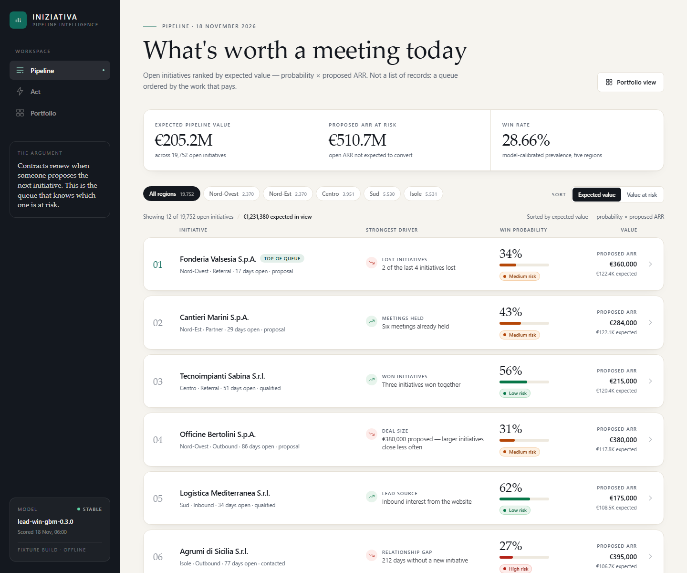
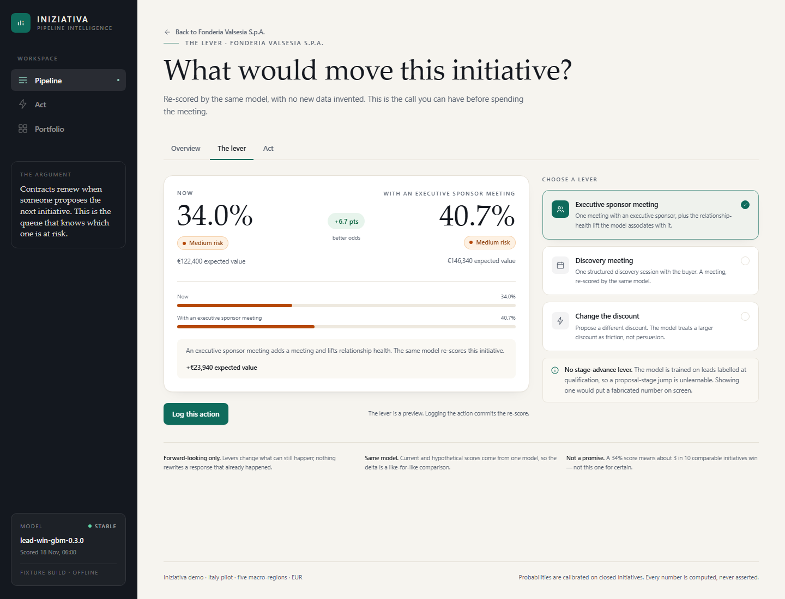
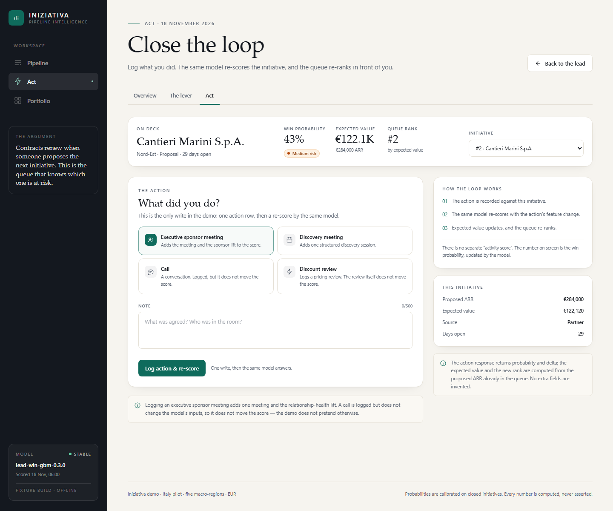

# Iniziativa — web

The pitch demo's UI. Five screens, one argument: a CRM for a business with no
renewal date, where the first screen is the open initiatives ranked by expected
value and every probability explains itself.

React + Vite + TypeScript + Tailwind + Recharts. The fixture build runs with no
backend, no network and no web fonts. `VITE_API_BASE` switches the same UI to
the FastAPI service.

| Screen | What it proves |
|---|---|
| [Pipeline](#pipeline-queue) | The first screen is a ranked queue, not a list of records. |
| [Lead 360](#lead-360) | Every probability explains itself in three business drivers. |
| [The lever](#the-lever) | The rep can see what would move it before spending the meeting. |
| [Act](#act) | Logging an action re-scores the lead and moves it in the queue. |
| [Portfolio](#portfolio) | Five regions, one calibrated model; 34% means 34%. |

---

## Run it

Requires Node 20+ and pnpm. The fixture build is the default.

```sh
pnpm --dir web install
pnpm --dir web dev
```

Open <http://localhost:5173>. There is no API call, no database and no network
fetch in this mode; the JSON fixtures are bundled.

```sh
pnpm --dir web build     # tsc --noEmit && vite build
pnpm --dir web preview   # serves dist on http://localhost:4173
pnpm --dir web fixtures  # regenerate + validate src/fixtures/
```

`pnpm --dir web install` needs pnpm's build approval for esbuild. It is committed
in `pnpm-workspace.yaml` (`allowBuilds: esbuild: true`), not hidden in a local
config.

## Point it at the live API

Set `VITE_API_BASE` when starting Vite (or when building a static bundle):

```sh
# macOS / Linux
VITE_API_BASE=http://localhost:8000 pnpm --dir web dev

# PowerShell
$env:VITE_API_BASE = "http://localhost:8000"
pnpm --dir web dev
```

```sh
VITE_API_BASE=http://localhost:8000 pnpm --dir web build
```

Vite reads the variable at startup/build time, so rebuild after changing it.
The API must allow the web origin with CORS (API on `:8000`, web dev on `:5173`).

Endpoints the UI uses:

| Call | Where |
|---|---|
| `GET /api/pipeline?limit=50` | Pipeline queue (fetched once; region and sort are applied client-side so the queue can re-rank locally after an action) |
| `GET /api/leads/{id}` | Lead 360 and the lever |
| `GET /api/portfolio` | Portfolio regions, calibration bins, drift |
| `GET /api/health` | Model version and last scoring time in the shell |
| `POST /api/leads/{id}/counterfactual` | The lever's re-score |
| `POST /api/leads/{id}/actions` | Act's one write, then the re-score |

There is deliberately no silent fallback from live to fixtures. If the service is
unreachable the shell says so on the boot card; the demo should not show stale
numbers and call them live.

---

## The fixtures

`src/fixtures/` is generated from one authored world in
`scripts/build-fixtures.mjs`. The JSON is committed and imported statically; the
app never runs the script. This exists so the queue, lead pages, lever, act loop
and portfolio cannot drift apart.

```
src/fixtures/
  pipeline.json        # GET /api/pipeline — 12 top-of-queue items, total 19,752
  leads.json           # GET /api/leads/{id} — one LeadDetail per queue item
  counterfactuals.json # POST /counterfactual — 9 lever states per lead
  actions.json         # POST /actions — re-score per lead × action kind
  portfolio.json       # GET /api/portfolio — regions, calibration, drift
  health.json          # GET /api/health
scripts/build-fixtures.mjs  # single authoring source + validation
```

### The numbers and where they come from

The task facts and the generator's own constants are the only inputs:

| Fact | Value | Use |
|---|---|---|
| Open initiatives | **19,752** | Queue total, portfolio coverage |
| Win prevalence | **28.66%** | Portfolio win rate |
| Model AUC | **0.773** | Portfolio ranking quality |
| Calibration error | **0.0104** | Calibration chart |
| Latent ceiling | **0.789** | The honest upper bound on AUC |
| Mean proposed ARR | **€36,246.05** | `data/generator.py` `CALIBRATED_Z.amount_arr` |
| Regions | 5 | Nord-Ovest, Nord-Est, Centro, Sud, Isole |

The portfolio is rolled up consistently:

- Region split: 2,370 / 2,370 / 3,951 / 5,530 / 5,531 = **19,752**.
- Wins per region: 758 / 802 / 1,225 / 1,499 / 1,377 = **5,661**.
- 5,661 / 19,752 = **28.66%**.
- Open proposed ARR = 19,752 × €36,246.05 = **€715.9M**.
- Expected value = **€205.19M**; value at risk = **€510.7M**.
- Region expected value = open leads × regional win rate × mean proposed ARR,
  rounded to €10k. The five values sum to €205.19M.

The ten calibration bins are constructed so that their predicted means average
to 28.66% and their equally weighted mean absolute gap is exactly **0.0104**:

| Predicted | 5.5% | 9.5% | 14.0% | 19.0% | 24.0% | 29.5% | 35.5% | 42.0% | 49.0% | 58.6% |
|---|---|---|---|---|---|---|---|---|---|---|
| Actual | 6.7% | 8.5% | 14.9% | 17.7% | 25.1% | 28.7% | 36.9% | 41.0% | 49.7% | 57.6% |

Drift is a single current value (`PSI 0.041`, `stable`). It is a fixture because
the contract has no history; see the gaps below.

### Counterfactual fixture math

The fixture re-score uses the documented feature effects in `docs/LABEL.md`,
not a hand-picked percentage:

- one meeting: `+0.25` logit (z of 1 meeting at the fixed reference scale)
- +5 NPS: `+0.20 × 5 × 1.25 / 34.99` logit
- discount: `−0.20` logit per z of `discount_pct`, with the reference SD 8.357

At the demo lead's 34%, an executive sponsor meeting is **+6.7 points**
(34.0% → 40.7%), a discovery meeting **+5.8**, and raising the discount to 20%
is **−7.2** (34.0% → 26.8%). Those are the deltas the UI shows. With
`VITE_API_BASE` set, the real model's response replaces them.

Action fixtures follow the same rule: `exec_sponsor_meeting` and
`discovery_meeting` carry the deltas above; `call` and `discount_review` carry
zero because they are activity, not a feature the model learned from.

### The pitch's two stale numbers

`docs/PITCH.md` says "€4.2M of pipeline" and "34% to 52%". Neither survives the
fixed world, so the UI does not print them:

- **€4.2M** would imply €213 of expected value per open initiative. The
  generator's mean proposed ARR is €36,246 and prevalence is 28.66%, so the
  book is **€205.2M**. The screen shows the derived number.
- **34% → 52%** would require a +18-point lever. The documented executive
  sponsor meeting is one meeting plus +5 NPS: about +6.7 points at 34%. A
  +18-point jump would be a fabricated number, which `docs/DECISIONS.md`
  explicitly rules out. The screen shows the model-consistent **34% → 40.7%**.

If the pitch wants those exact numbers, either the world or the lever definition
has to change in `docs/LABEL.md` — not in the UI. See "What the contract does
not carry" for the related stage-lever finding.

---

## The five screens

### Pipeline queue



- `€205.2M` expected value across 19,752 open initiatives, `€510.7M` of proposed
  ARR at risk, 28.66% calibrated win rate.
- Region filter with real counts (All / Nord-Ovest / Nord-Est / Centro / Sud /
  Isole) and a sort switch: expected value, or value at risk `(1-p) × ARR`.
- Every row is a card, not a table cell: rank, company, region/source/days open,
  the single strongest driver as a sentence, win probability with a risk band,
  proposed ARR and expected value.
- The top of the queue is the demo lead; the second row is the one the Act
  screen uses to show a queue move.

### Lead 360


- Company, region, industry, employees, stage and days open.
- A calibrated probability dial with the portfolio benchmark at 28.66%, the win
  probability, the risk band, expected value and proposed ARR.
- **Three drivers as business sentences** ("2 of the last 4 initiatives lost",
  "11 hours to first response", "Rep wins 41% of initiatives"), each with its
  direction and a relative influence bar.
- Company context: lifetime won ARR, won/lost counts, last initiative and days
  since, dormancy state, and the initiative history that makes "2 of the last 4
  lost" auditable.
- Open actions. The demo lead has a call already booked; that is why the Act
  screen's default next call is the second row.

### The lever



- Current vs hypothetical probability, delta in points, expected value before
  and after, and a two-bar comparison.
- Three levers, exactly the contract's: **executive sponsor meeting**,
  **discovery meeting**, **discount %**. No stage-advance lever.
- The explanation comes from the API (fixtures in this build), not from the UI
  inventing a reason.
- The discount is a slider (0–30%); it is a **preview only**. The action contract
  has no field for a proposed discount value, so the UI does not pretend the
  preview can be committed exactly. Meetings can be committed and carry their
  kind into Act.


### Act




- Defaults to the second queue row — the highest-value initiative without an
  action already open, which makes the rank movement visible.
- Four action kinds from the contract: call, executive sponsor meeting,
  discovery meeting, discount review; optional note (500 chars).
- On submit the API returns `probability_after` and `delta`; the UI computes the
  new expected value from the proposed ARR already in the queue, then re-ranks.
- The screen shows the before/after queue explicitly: **#2 → #1**, with both
  lists on screen and the acted row highlighted. `call` and `discount_review`
  correctly show a zero delta — a call is activity, not a lever.
- The updated probability is held in the queue context, so going back to the
  lead or the lever shows the new score; the lever re-bases its logit effect on
  the current probability rather than replaying the original one.

### Portfolio


- Expected value, calibrated win rate, AUC, calibration error.
- Pipeline value by region (Recharts horizontal bars) and win rate by region
  with the 28.66% portfolio benchmark marked on every row.
- Calibration chart: ten decile bins on predicted vs actual win rate, with the
  perfect-calibration diagonal. The mean calibration error is 0.0104.
- Drift/status panel: PSI 0.041, stable, one panel only; AUC 0.773 against the
  latent ceiling 0.789; model version and last scoring time from `/api/health`.

---

## Risk bands

The OpenAPI `Band` enum names four bands but does not define the cut points. The
UI treats them as **risk** bands and applies these consistently, including after
a re-score:

| Band | Probability |
|---|---|
| critical | `< 15%` |
| high | `15% – < 30%` |
| medium | `30% – < 50%` |
| low | `≥ 50%` |

They live in `src/lib/bands.ts`; changing them changes the fixture output via
`scripts/build-fixtures.mjs`, and the fixtures are validated on regeneration.

## Model numbers the API does not carry

`/api/portfolio` returns the calibration bins and the current drift PSI. It does
**not** return AUC, ECE or the latent ceiling, and it has no proposed-ARR total.
The Portfolio screen reads those from `src/lib/model.ts`, sourced from the build
facts (`ml/artifacts/metrics.json` in the full project). The UI labels them as
build metrics rather than inventing fields on the wire.

---

## What the contract does not carry

These are the places where a screen needed something the OpenAPI file does not
provide. None of them is hidden behind a made-up number.

| Gap | Screen impact | What this build does |
|---|---|---|
| `Portfolio` has no AUC, ECE or latent ceiling | The "three numbers to have ready" are not in the payload | Constants in `src/lib/model.ts`, shown as build metrics |
| `Portfolio` has no time series, only current `psi` + `status` | No honest trend chart can be drawn | Region chart + calibration chart (both Recharts) + one status panel; no fabricated trend |
| `Band` thresholds are undefined | Risk colouring is ambiguous | Documented cut points above; the UI re-bands every re-score |
| `Lead` has no stage-entry timestamp | The pitch's "six days into the proposal stage" cannot be rendered | Stage is shown; it is not a driver, because it is constant in training and unlearnable |
| `ActionRequest` has no `discount_pct` field | A discount preview cannot be committed exactly | Discount lever is labelled "Preview only"; meetings commit and carry their kind into Act |
| `ActionResponse` has no expected value, rank or drivers | The loop cannot read the new queue position from the write | Expected value = `probability_after × amount_arr` from the queue item; rank re-computed client-side |
| `PipelineItem` has no open-action state | The API cannot say which lead is the "next call" | Act defaults to the second queue row in fixtures and offers a picker; a live build defaults to the first |
| `by_region.win_rate` is undefined (closed win rate vs open expected rate) | Labelling risk | Shown as the calibrated win rate, with the raw open-lead counts beside it |
| `total_expected_value` scope is undefined (all matches vs returned page) | Headline could be misread | Fixtures define it as all 19,752 matches; the queue says "12 shown of 19,752" |
| No lift@10% or top-decile metric | The pitch's third "number to have ready" is missing | Omitted; the README does not estimate it |
| `CounterfactualResponse` has no per-driver change | The lever can say *what* moved, not *which feature* moved | The API `explanation` string is shown verbatim |

## File map

```
web/
  index.html
  package.json, pnpm-lock.yaml, pnpm-workspace.yaml
  vite.config.ts, tsconfig.json, tailwind.config.js, postcss.config.js
  scripts/build-fixtures.mjs
  src/
    main.tsx, App.tsx, index.css
    components/  AppShell, ui (dial, band, cards), QueueRow, RegionFilter,
                 LeadTabs, icons
    pages/       PipelinePage, LeadPage, LeverPage, ActPage, PortfolioPage
    lib/         types (OpenAPI mirror), api (fixture/live switch), bands,
                 format, model, narratives
    state/       PipelineProvider (queue, lead overrides, action re-rank)
    fixtures/    committed JSON
  screenshots/   captures from the fixture build
```

No file outside `web/` is modified by this lane. The root `.gitignore` already
ignores `web/dist/`, `node_modules/` and logs.

## Verification

```sh
pnpm --dir web install
pnpm --dir web build
pnpm --dir web dev
```

Last build:

```
dist/index.html                   0.62 kB │ gzip:   0.37 kB
dist/assets/index-D6Qru8Sg.css   29.79 kB │ gzip:   6.49 kB
dist/assets/index-D4BJwfCR.js   670.96 kB │ gzip: 187.04 kB
✓ built
```

The bundle is large because Recharts is bundled for the Portfolio screen; for a
demo laptop that is a deliberate trade (no route-level spinner). The app is
fully offline in fixture mode.

The live path was also smoke-tested with `VITE_API_BASE` against a local HTTP
mock serving the same fixtures: `/api/pipeline`, `/api/leads/{id}`,
`/api/portfolio` and `/api/health` rendered, and both POSTs (counterfactual and
action) returned a re-score that updated the UI. The mock is not committed; it
only proved the switch.

Screenshots are captured at 1440×1200–1600 with headless Chrome from the fixture
build; `act-result.png` is the post-click state after an executive sponsor
meeting on the second queue item.
